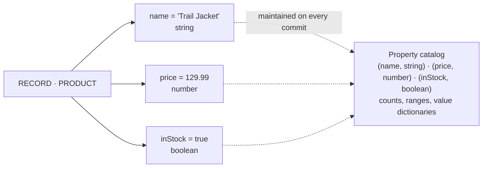

# Labeled Meta Property Graph

RushDB uses a **Labeled Meta Property Graph** model: application records remain flexible graph nodes, every property value is stored and typed on its own, and the field definitions those values form are kept as live, queryable metadata next to the data.

This page explains the model. You do not need to understand these details to store or query data, but they explain why RushDB can accept evolving JSON, expose its live schema, and help agents reason over unknown datasets.

## The Short Version

When you write:

```json
{
  "label": "PRODUCT",
  "data": {
    "name": "Trail Jacket",
    "price": 129.99,
    "inStock": true
  }
}
```

RushDB stores one `PRODUCT` record. Each of its values is stored as its own typed entry — an **occurrence** of a property on the record — rather than inside one document. In the same commit, RushDB updates the **property catalog** with the definitions those values form:

```text
PRODUCT · (name, string)    · 1 record
PRODUCT · (price, number)   · 1 record
PRODUCT · (inStock, boolean)· 1 record
```



The values stay with the record; the catalog holds definitions, counts and value statistics, never a second copy of your data.

## Why a Property Catalog

Most databases keep schema outside the data:

- relational databases define columns in table metadata;
- document stores often leave field discovery to application code or sampling;
- conventional property graphs store values directly on nodes but do not necessarily maintain a queryable field catalog.

RushDB maintains the catalog as part of every write, so it is exact and never needs a scan. This provides:

| Capability               | Why the metadata layer helps                                                     |
| ------------------------ | -------------------------------------------------------------------------------- |
| Runtime schema discovery | RushDB can enumerate the fields that actually exist                              |
| Type-aware querying      | Agents and applications can inspect types before building filters                |
| Value exploration        | Property IDs provide a stable handle for distinct values and numeric/date ranges |
| Flexible ingestion       | New fields appear on write without a migration                                   |
| Schema evolution         | Old and new record shapes can coexist while the live schema reflects both        |
| Semantic indexing        | Embedding and text indexes attach to a label and property name discovered from the data |

## Records, Labels, Properties, Relationships

| Layer               | Stores                                                  | Example                            |
| ------------------- | ------------------------------------------------------- | ---------------------------------- |
| Record              | Application values, each typed, and system metadata     | `PRODUCT { name, price, inStock }` |
| Label               | The record's entity type                                | `PRODUCT`, `ORDER`, `SESSION`      |
| Property definition | A field identified by `(name, type)`, with its counts   | `(price, number)`                  |
| Relationship        | A directed, typed edge between records, with properties | `ORDER -[CONTAINS]-> PRODUCT`      |

Records remain the source of truth for values. The catalog describes the shape of those records.

## Identity Is Name Plus Type

Property identity includes both the field name and its inferred type. If different records send:

```json
[
  { "label": "PRODUCT", "data": { "size": "M" } },
  { "label": "PRODUCT", "data": { "size": 42 } }
]
```

RushDB can represent both definitions:

```text
(size, string)
(size, number)
```

This preserves information instead of forcing unrelated values into one rigid column. It also gives you a signal that upstream data may need normalization.

For predictable queries, keep a property's type consistent within an entity model whenever possible.

## How the Schema Emerges

Every write passes through the same conceptual pipeline:

1. **Accept JSON** — receive flat or nested input.
2. **Infer types** — classify scalar and array values.
3. **Create records** — store each application value as a typed occurrence on its record.
4. **Update the catalog** — record each `(name, type)` definition with its counts and value statistics, in the same commit.
5. **Decompose nested objects** — create child records and parent-child relationships where needed.

No schema declaration is required before step 1. The schema emerges from successful writes.

## From Catalog to Schema

The schema APIs read the catalog into a runtime schema snapshot, without scanning records:

```text
getSchemaMarkdown()
  → labels and record counts
  → properties per label
  → inferred types
  → numeric and datetime ranges
  → sample string and boolean values
  → relationship directions
  → semantic index availability
```

Agents should call `getSchemaMarkdown` before constructing queries. Applications that need structured metadata for filters or admin interfaces can call `getSchema`.

For deeper inspection:

| API                 | Use                                                             |
| ------------------- | --------------------------------------------------------------- |
| `findProperties`    | List property definitions and their IDs                         |
| `propertyValues`    | Enumerate string/boolean values or retrieve numeric/date ranges |
| `findLabels`        | List labels and record counts                                   |
| `findRelationships` | Explore edges between record types                              |

## Adaptive Does Not Mean Uncontrolled

RushDB does not require upfront migrations, but production data still benefits from conventions:

- use stable labels for entity types;
- use consistent property names and types;
- use ISO 8601 timestamps;
- model state with fields such as `status`, not new labels;
- inspect schema output during ingestion development;
- normalize accidental type drift at the source when possible.

The goal is not to eliminate structure. The goal is to let structure emerge from real data, remain inspectable, and evolve without blocking writes.

## Tradeoffs

The metadata layer is useful because it is explicit, but it is not free:

| Tradeoff                                    | Practical implication                                                                     |
| ------------------------------------------- | ----------------------------------------------------------------------------------------- |
| Type drift remains visible                  | Mixed `(name, type)` definitions can appear until data is normalized                      |
| Flexible records require disciplined naming | `userId` and `userID` are distinct fields                                                 |
| Discovery is runtime state                  | Schema reflects what has been written, not an aspirational schema file                    |
| Storage favours property-grained work       | Updating one property writes one key; reading a whole record is one ordered scan of its occurrences |

## Next Steps

- [Labels & Properties](./labels-and-properties.mdx) — inspect and manage schema metadata through public APIs
- [Discover Your Schema](./discover-your-schema.mdx) — retrieve the live schema
- [Import Data](./import-data.mdx) — create records and relationships from nested JSON
- [Relationships](../relationships/index.mdx) — understand explicit and generated graph edges
- [LMPG layout](../../engine/architecture/lmpg-layout.md) and [Schema catalog](../../engine/data-model/schema-catalog.md) in the engine manual — how occurrences and the catalog are stored
