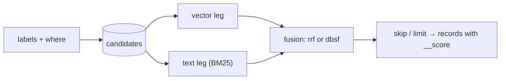

import Tabs from '@site/src/components/LanguageTabs'
import TabItem from '@theme/TabItem'

# Hybrid Search

A hybrid search ranks the same records two ways, by vector similarity and by BM25 keywords, and fuses the two rankings into one. Meaning finds the paraphrases; keywords keep exact names, codes and rare terms from being drowned out. Add a `text` leg to [`vectorSearch`](./semantic-search.mdx) and the engine does the rest in one request.

It needs an embedding index for the vector leg and a [text index](./keyword-search.mdx) for the text leg. It works on RushDB Cloud and on a self-hosted engine; on a self-hosted engine, pass a `queryVector` from your own model.

---

## How it runs

1. **Filter once.** `labels` and `where` select one set of candidate records.
2. **Rank inside the candidates.** The vector leg and the text leg each rank only those records, so a record outside the filter never takes a top slot.
3. **Fuse.** Each leg contributes to every record it returned; a record both legs found gets both contributions.
4. **Page.** Results are sorted by fused score, then `skip` and `limit` apply.



---

## Search

<Tabs groupId="programming-language">
  <TabItem value="python" label="Python" default>

```python
result = db.records.vector_search({
    "index": "Article.body.text-embedding-3-small.1536.cosine",
    "query": "how do graph databases store relationships",  # Cloud; use queryVector on a self-hosted engine
    "text": {"query": "index-free adjacency"},
    "where": {"status": "published"},
    "limit": 10,
})

print(result.meta["fusion"], result.meta["vectorSearch"], result.meta["textSearch"])
```

  </TabItem>
  <TabItem value="typescript" label="TypeScript">

```typescript
const result = await db.records.vectorSearch({
  index: 'Article.body.text-embedding-3-small.1536.cosine',
  query: 'how do graph databases store relationships', // Cloud; use queryVector on a self-hosted engine
  text: { query: 'index-free adjacency' },
  where: { status: 'published' },
  limit: 10
})

console.log(result.fusion, result.vectorSearch, result.textSearch)
```

  </TabItem>
  <TabItem value="shell" label="Shell">

```bash
curl -X POST https://api.rushdb.com/api/v1/ai/search \
  -H "Authorization: Bearer $RUSHDB_API_KEY" \
  -H "Content-Type: application/json" \
  -d '{
    "index": "Article.body.text-embedding-3-small.1536.cosine",
    "query": "how do graph databases store relationships",
    "text": {"query": "index-free adjacency"},
    "where": {"status": "published"},
    "limit": 10
  }'
```

  </TabItem>
</Tabs>

The text leg's `query` defaults to the vector `query`, and its index to the one ready text index of the first label. `text` also takes `index`, `property`, `allTerms` and `phrase`, as in [keyword search](./keyword-search.mdx).

---

## Fusion

| `fusion`        | A leg's contribution to a record                                                                  | Use when                                                                 |
| --------------- | ------------------------------------------------------------------------------------------------- | ------------------------------------------------------------------------ |
| `rrf` (default) | `weight / (rrfK + rank + 1)`, `rank` counted from 0                                               | The legs' scores aren't comparable; the robust default.                  |
| `dbsf`          | `weight × normalized score`: each leg's scores mapped by that leg's own mean ± 3σ to `[0, 1]`     | How far ahead a record is within a leg should count, not only its place. |

| Parameter            | Where             | Default                | Description                                                                 |
| -------------------- | ----------------- | ---------------------- | --------------------------------------------------------------------------- |
| `fusion`             | top level         | `rrf`                  | How the legs combine.                                                       |
| `rrfK`               | top level         | `60`                   | RRF smoothing: smaller lets top-ranked hits dominate, larger favours agreement between legs. |
| `weight`             | top level         | `1`                    | The vector leg's share of the fused score.                                  |
| `prefetchLimit`      | top level         | `4 × (skip + limit)`   | Hits the vector leg ranks before fusion (1–10,000).                         |
| `text.weight`        | `text`            | `1`                    | The text leg's share; `0` leaves the vector order.                          |
| `text.prefetchLimit` | `text`            | `4 × (skip + limit)`   | Hits the text leg ranks before fusion (1–10,000).                           |

At least one weight must be above 0. The fused score is `__score` on each record; the result reports which `fusion` ran.

```typescript
// Trust keywords half as much, and let a strong lead within a leg count
await db.records.vectorSearch({
  index: 'Article.body.text-embedding-3-small.1536.cosine',
  queryVector,
  text: { query: 'index-free adjacency', weight: 0.5 },
  fusion: 'dbsf',
  limit: 10
})
```

---

## See also

- [Keyword Search](./keyword-search.mdx) — text indexes and BM25 search on their own
- [Semantic Search](./semantic-search.mdx) — the vector leg's parameters
- [Hybrid search in the engine manual](../../engine/indexes-and-search/hybrid-search.md) — the engine's request, fusion details and tuning
