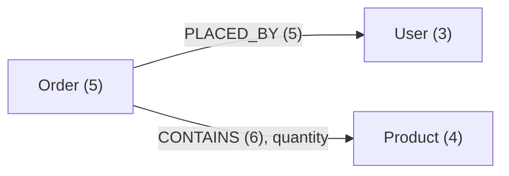

import Tabs from '@site/src/components/LanguageTabs'
import ThemeTabs from '@theme/Tabs'
import TabItem from '@theme/TabItem'

# Schema self-awareness

RushDB is **self-aware** — it continuously tracks its own structure and exposes it on demand. Agents use this to operate against an unknown or evolving knowledge graph without any hardcoded schema documentation.

---

## Why schema discovery matters

Without schema discovery, AI agents hallucinate field names, use wrong label casing, and construct invalid queries. With a single schema call at session start, the agent knows:

- Every label and how many records it has
- Every property per label, its type, and sample/range values
- The full relationship map (which labels connect to which)
- Which properties are semantically searchable (have embedding indexes)

---

## What the agent receives

Take a small shop: three users, four products and five orders. Each order is linked to the user who placed it and to the products it contains, with a `quantity` on each `CONTAINS` relationship. Product descriptions have a vector index.



The schema comes in two formats with the same content: Markdown for an LLM's context, and JSON for code. Both examples below are the real output for this data from RushDB Cloud.

<ThemeTabs groupId="schema-format">
  <TabItem value="markdown" label="Markdown" default>

`getSchemaMarkdown()` returns one Markdown document: a table of labels, then a section per label with its properties, the relationships it takes part in, and the properties of those relationships.

```text
# Graph Schema

## Labels

| Label | Count |
|-------|------:|
| `Order` | 5 |
| `Product` | 4 |
| `User` | 3 |

---

## `Order` (5 records)

### Properties

| Property | ID | Type | Values / Range | Semantic Search |
|----------|----|------|----------------|-----------------|
| `createdAt` | `p000000000000000b` | datetime | `2026-10-02T09:15:00.000Z`..`2026-11-03T11:00:00.000Z` | — |
| `status` | `p0000000000000009` | string | `paid`, `shipped`, `pending`, `cancelled` | — |
| `total` | `p000000000000000a` | number | `79.8`..`499` | — |

### Relationships

| Traversal | Count | Edge Properties |
|-----------|------:|-----------------|
| `(Order)-[:CONTAINS]->(Product)` | 6 | `quantity:number` |
| `(Order)-[:PLACED_BY]->(User)` | 5 | — |

### Relationship Properties

| Traversal | Property | Type | Values / Range | Relationships |
|-----------|----------|------|----------------|--------------:|
| `(Order)-[:CONTAINS]->(Product)` | `quantity` | number | `1`..`2` | 6 |

---

## `Product` (4 records)

### Properties

| Property | ID | Type | Values / Range | Semantic Search |
|----------|----|------|----------------|-----------------|
| `category` | `p0000000000000003` | string | `home`, `furniture`, `electronics`, `kitchen` | — |
| `description` | `p0000000000000007` | string | `Adjustable LED desk lamp`, `Electric sit-stand desk`, `Tenkeyless keyboard with brown switches`, `Burr grinder with 40 settings` | `Product.description.external.3.cosine` (external, cosine, 3d) [ready] |
| `inStock` | `p0000000000000005` | boolean | `true`, `false` | — |
| `name` | `p0000000000000000` | string | `Desk lamp`, `Standing desk`, `Mechanical keyboard`, `Coffee grinder` | — |
| `price` | `p0000000000000004` | number | `39.9`..`499` | — |
| `tags` | `p0000000000000006` | string[] | `lighting`, `office`, `ergonomic`, `coffee` | — |

### Relationships

| Traversal | Count | Edge Properties |
|-----------|------:|-----------------|
| `(Product)<-[:CONTAINS]-(Order)` | 6 | `quantity:number` |

### Relationship Properties

| Traversal | Property | Type | Values / Range | Relationships |
|-----------|----------|------|----------------|--------------:|
| `(Product)<-[:CONTAINS]-(Order)` | `quantity` | number | `1`..`2` | 6 |

---

## `User` (3 records)

### Properties

| Property | ID | Type | Values / Range | Semantic Search |
|----------|----|------|----------------|-----------------|
| `email` | `p0000000000000001` | string | `alice@example.com`, `bob@example.com`, `carol@example.com` | — |
| `name` | `p0000000000000000` | string | `Alice`, `Bob`, `Carol` | — |
| `plan` | `p0000000000000002` | string | `pro`, `free`, `enterprise` | — |

### Relationships

| Traversal | Count | Edge Properties |
|-----------|------:|-----------------|
| `(User)<-[:PLACED_BY]-(Order)` | 5 | — |
```

How to read it:

- **Values / Range** shows up to 5 sample values for strings and booleans (with `(+N more)` when there are more) and `min`..`max` for numbers and dates. Values longer than 48 characters are cut short.
- **Type** ends in `[]` when records store the property as an array, like `tags`.
- **Semantic Search** names each vector index on the property, with its source, similarity, dimensions and status. Only a `[ready]` index can be queried.
- **Traversal** is the pattern rooted at the section's label: `->` for an outgoing relationship, `<-` for an incoming one. In a `where` traversal, nest the other label and set `$relation: { type, direction }`, with `out` for `->` and `in` for `<-`.
- **ID** is the property's ID for `db.properties.values()`. A property with the same name and type has the same ID under every label, like `name` here.

</TabItem>
<TabItem value="json" label="JSON">

`getSchema()` returns the same content as an array with one item per label, largest label first:

```json
[
  {
    "label": "Order",
    "count": 5,
    "properties": [
      {
        "id": "p000000000000000b",
        "name": "createdAt",
        "type": "datetime",
        "recordsCount": 5,
        "isArray": false,
        "min": "2026-10-02T09:15:00.000Z",
        "max": "2026-11-03T11:00:00.000Z"
      },
      {
        "id": "p0000000000000009",
        "name": "status",
        "type": "string",
        "recordsCount": 5,
        "isArray": false,
        "values": [
          "paid",
          "shipped",
          "pending",
          "cancelled"
        ],
        "min": "cancelled",
        "max": "shipped"
      },
      {
        "id": "p000000000000000a",
        "name": "total",
        "type": "number",
        "recordsCount": 5,
        "isArray": false,
        "min": 79.8,
        "max": 499
      }
    ],
    "relationships": [
      {
        "label": "Product",
        "type": "CONTAINS",
        "direction": "out",
        "count": 6,
        "properties": [
          {
            "name": "quantity",
            "type": "number",
            "relationshipsCount": 6,
            "min": 1,
            "max": 2
          }
        ]
      },
      {
        "label": "User",
        "type": "PLACED_BY",
        "direction": "out",
        "count": 5
      }
    ]
  },
  {
    "label": "Product",
    "count": 4,
    "properties": [
      {
        "id": "p0000000000000003",
        "name": "category",
        "type": "string",
        "recordsCount": 4,
        "isArray": false,
        "values": [
          "home",
          "furniture",
          "electronics",
          "kitchen"
        ],
        "min": "electronics",
        "max": "kitchen"
      },
      {
        "id": "p0000000000000007",
        "name": "description",
        "type": "string",
        "recordsCount": 4,
        "isArray": false,
        "values": [
          "Adjustable LED desk lamp",
          "Electric sit-stand desk",
          "Tenkeyless keyboard with brown switches",
          "Burr grinder with 40 settings"
        ],
        "min": "Adjustable LED desk lamp",
        "max": "Tenkeyless keyboard with brown switches",
        "vectorIndexes": [
          {
            "id": "Product.description.external.3.cosine",
            "name": "Product.description.external.3.cosine",
            "sourceType": "external",
            "similarityFunction": "cosine",
            "dimensions": 3,
            "status": "ready",
            "modelKey": ""
          }
        ]
      },
      {
        "id": "p0000000000000005",
        "name": "inStock",
        "type": "boolean",
        "recordsCount": 4,
        "isArray": false,
        "values": [
          "true",
          "false"
        ],
        "min": "false",
        "max": "true"
      },
      {
        "id": "p0000000000000000",
        "name": "name",
        "type": "string",
        "recordsCount": 4,
        "isArray": false,
        "values": [
          "Desk lamp",
          "Standing desk",
          "Mechanical keyboard",
          "Coffee grinder"
        ],
        "min": "Coffee grinder",
        "max": "Standing desk"
      },
      {
        "id": "p0000000000000004",
        "name": "price",
        "type": "number",
        "recordsCount": 4,
        "isArray": false,
        "min": 39.9,
        "max": 499
      },
      {
        "id": "p0000000000000006",
        "name": "tags",
        "type": "string",
        "recordsCount": 4,
        "isArray": true,
        "values": [
          "lighting",
          "office",
          "ergonomic",
          "coffee"
        ]
      }
    ],
    "relationships": [
      {
        "label": "Order",
        "type": "CONTAINS",
        "direction": "in",
        "count": 6,
        "properties": [
          {
            "name": "quantity",
            "type": "number",
            "relationshipsCount": 6,
            "min": 1,
            "max": 2
          }
        ]
      }
    ]
  },
  {
    "label": "User",
    "count": 3,
    "properties": [
      {
        "id": "p0000000000000001",
        "name": "email",
        "type": "string",
        "recordsCount": 3,
        "isArray": false,
        "values": [
          "alice@example.com",
          "bob@example.com",
          "carol@example.com"
        ],
        "min": "alice@example.com",
        "max": "carol@example.com"
      },
      {
        "id": "p0000000000000000",
        "name": "name",
        "type": "string",
        "recordsCount": 3,
        "isArray": false,
        "values": [
          "Alice",
          "Bob",
          "Carol"
        ],
        "min": "Alice",
        "max": "Carol"
      },
      {
        "id": "p0000000000000002",
        "name": "plan",
        "type": "string",
        "recordsCount": 3,
        "isArray": false,
        "values": [
          "pro",
          "free",
          "enterprise"
        ],
        "min": "enterprise",
        "max": "pro"
      }
    ],
    "relationships": [
      {
        "label": "Order",
        "type": "PLACED_BY",
        "direction": "in",
        "count": 5
      }
    ]
  }
]
```

For the meaning of each field, see the [schema types](../records-and-queries/discover-your-schema.mdx#typescript-types).

  </TabItem>
</ThemeTabs>

:::note Self-hosted engine
With an SDK in direct mode, the JSON is the same, except that relationship properties carry only `name`, `type` and `relationshipsCount`. The Markdown has no **ID** column and no **Relationship Properties** section. An index that is missing vectors for some records reports `behind` instead of `awaiting_vectors`.
:::

---

## Inject schema into LLM context

<Tabs groupId="programming-language">
  <TabItem value="python" label="Python" default>

```python
from rushdb import RushDB

db = RushDB("RUSHDB_API_KEY")

# Call once at session start
response = db.ai.get_schema_markdown()
schema = response.data

# Inject into LLM system prompt
messages = [
    {
        "role": "system",
        "content": f"""You are a database assistant for RushDB.

Here is the current graph schema:

{schema}

When the user asks questions, construct SearchQuery filters using ONLY the labels and properties shown above. Never invent field names."""
    },
    {"role": "user", "content": "How many paid orders were placed this month?"}
]
```

  </TabItem>
  <TabItem value="typescript" label="TypeScript">

```typescript
import RushDB from '@rushdb/javascript-sdk'

const db = new RushDB('RUSHDB_API_KEY')

// Call once at session start
const { data: schema } = await db.ai.getSchemaMarkdown()

// Inject into LLM system prompt
const messages = [
  {
    role: 'system',
    content: `You are a database assistant for RushDB.

Here is the current graph schema:

${schema}

When the user asks questions, construct SearchQuery filters using ONLY the labels and properties shown above. Never invent field names.`
  },
  {
    role: 'user',
    content: 'How many paid orders were placed this month?'
  }
]
```

  </TabItem>
  <TabItem value="shell" label="Shell">

```bash
# Get Markdown schema for LLM injection
curl -X POST https://api.rushdb.com/api/v1/ai/schema/md \
  -H "Authorization: Bearer $RUSHDB_API_KEY" \
  -H "Content-Type: application/json" \
  -d '{}'

# Scope to specific labels (reduces token usage)
curl -X POST https://api.rushdb.com/api/v1/ai/schema/md \
  -H "Authorization: Bearer $RUSHDB_API_KEY" \
  -H "Content-Type: application/json" \
  -d '{"labels": ["Order", "User"]}'
```

  </TabItem>
</Tabs>

---

## Dynamic query construction

Use structured schema to build queries programmatically — no hardcoded field names:

<Tabs groupId="programming-language">
  <TabItem value="python" label="Python" default>

```python
# Get structured schema
schema = db.ai.get_schema().data

# Find a label
order_schema = next(item for item in schema if item["label"] == "Order")

# Enumerate all string properties
string_props = [
    p for p in order_schema["properties"] if p["type"] == "string"
]

# Find properties with semantic indexes ready
searchable = [
    p for p in order_schema["properties"]
    if any(idx["status"] == "ready" for idx in p.get("vectorIndexes", []))
]

# Look up a property ID for value enumeration
status_prop = next(p for p in order_schema["properties"] if p["name"] == "status")
statuses = db.properties.values(status_prop["id"])
```

  </TabItem>
  <TabItem value="typescript" label="TypeScript">

```typescript
// Get structured schema
const { data: schema } = await db.ai.getSchema()

// Find a label
const orderSchema = schema.find((item) => item.label === 'Order')!

// Enumerate all string properties
const stringProps = orderSchema.properties.filter((p) => p.type === 'string')

// Find properties with semantic indexes ready
const searchable = orderSchema.properties.filter((p) =>
  p.vectorIndexes?.some((idx) => idx.status === 'ready')
)

// Look up a property ID for value enumeration
const statusProp = orderSchema.properties.find((p) => p.name === 'status')!
const { data: statuses } = await db.properties.values(statusProp.id)
```

  </TabItem>
  <TabItem value="shell" label="Shell">

```bash
# Get full structured JSON schema
curl -X POST https://api.rushdb.com/api/v1/ai/schema \
  -H "Authorization: Bearer $RUSHDB_API_KEY" \
  -H "Content-Type: application/json" \
  -d '{}'
```

  </TabItem>
</Tabs>

---

## Schema caching

On RushDB Cloud, both schema endpoints share one cached schema per project, kept for an hour. After that, a call still gets the cached schema straight away while a refresh runs in the background, so no call waits for a recalculation unless the project has no cached schema yet or you pass `force: true`. `force` waits for a schema that includes every write made before the call. With an SDK in direct mode there is no cache: each call reads the engine's catalog.

<Tabs groupId="programming-language">
  <TabItem value="python" label="Python" default>

```python
# Recalculate now instead of using the cached schema
response = db.ai.get_schema_markdown({"force": True})
```

  </TabItem>
  <TabItem value="typescript" label="TypeScript">

```typescript
// Recalculate now instead of using the cached schema
const { data } = await db.ai.getSchemaMarkdown({ force: true })
```

  </TabItem>
  <TabItem value="shell" label="Shell">

```bash
curl -X POST https://api.rushdb.com/api/v1/ai/schema/md \
  -H "Authorization: Bearer $RUSHDB_API_KEY" \
  -H "Content-Type: application/json" \
  -d '{"force": true}'
```

  </TabItem>
</Tabs>

---

## Agent skills

`@rushdb/skills` is a collection of installable agent skills that teach any skills-compatible AI assistant (Claude, GitHub Copilot, Cursor, Windsurf, and others) to use RushDB efficiently — without manual system-prompt engineering.

```bash
npx skills add rush-db/skills
```

| Skill                    | What it teaches                                                                                                                                                   |
| ------------------------ | ----------------------------------------------------------------------------------------------------------------------------------------------------------------- |
| `rushdb-query-builder`   | Discovery-first queries, traversals, aggregation, and scope-safe semantic recall                                                                                  |
| `rushdb-agent-memory`    | Route persistent memory across native providers, MCP, and custom harnesses without duplicate writes                                                               |
| `rushdb-memory-adapter`  | Build and validate lifecycle-aware RushDB memory plugins and providers                                                                                            |
| `rushdb-data-modeling`   | LMPG model design, nested imports, schema evolution, and canonical memory records                                                                                 |
| `rushdb-faceted-search`  | Build faceted filter UIs — discover properties and types, enumerate distinct values, map to widgets, assemble a live `where` clause                               |
| `rushdb-domain-template` | Design a tailored schema for any domain through guided conversation — interview, entity/relationship mapping, bootstrap payload, and 10 built-in domain templates |

Each skill bundles a `SKILL.md` with concise instructions and optional reference files that the agent loads on demand.

:::note MCP server vs. Agent Skills
The [MCP server](../../connect/mcp.mdx) gives agents direct tool access to RushDB at runtime. Agent Skills teach agents _how_ to use those tools correctly — they complement each other.
:::

---

## See also

- [Agent Memory Overview](./index.mdx) — three-layer memory model
- [Discover Your Schema](../records-and-queries/discover-your-schema.mdx) — full schema API reference
- [Semantic Search](../semantic-search/semantic-search.mdx) — search by meaning
- [Find & Query](../records-and-queries/find-and-query.mdx) — search by structure
