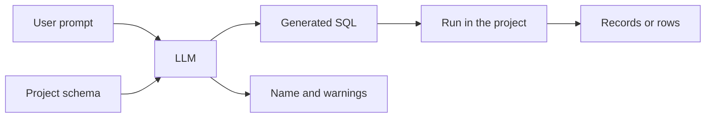

import Tabs from '@site/src/components/LanguageTabs'
import TabItem from '@theme/TabItem'

# Smart search

:::info Cloud
This capability is provided by RushDB Cloud. It is not available on a self-hosted engine, where the SDK throws `CloudOnlyError` before sending anything; write the [SQL](../../engine/languages/sql.md) yourself, or have an agent write it from [`getSchemaMarkdown`](../agent-memory/schema-self-awareness.mdx).
:::

Smart Search turns a natural-language request into one read-only SQL statement over your project's schema, runs it, and returns the results.

Use it when the user asks for data in product language:

- "Who are piloting Falcon?"
- "How many orders per city?"
- "Show active enterprise customers created last quarter"

Use [`records.vectorSearch()`](../semantic-search/semantic-search.mdx) instead when you already know the indexed property and want direct vector similarity.

---

## How it works



Under the hood, RushDB:

1. Reads the project schema: labels, properties, types and relationship map.
2. Sends the schema and your prompt (with today's date, for relative dates) to the model.
3. Receives one read-only SQL statement, a short title for it, and any warnings. RushDB plans the statement before returning it and asks the model once to fix it if it does not plan.
4. Runs the statement in your project only. [Labels are tables and relationship types are `rushdb_edges.<type>` tables](../../engine/languages/sql.md#how-the-graph-maps-to-tables).
5. Returns full records for rows that select a record's `__id`, and plain rows for aggregates such as counts and totals.

Smart Search does **not** rank by embedding similarity. It is for schema-aware structured, relational, filtered and aggregate search.

---

## SDK usage

<Tabs groupId="programming-language">
  <TabItem value="typescript" label="TypeScript" default>

```typescript
const results = await db.ai.search('Find active enterprise customers created last quarter')

console.log(results.sql) // the statement that ran
console.log(results.name) // a short title, e.g. to save the query under
console.log(results.warnings)

for (const record of results.data) {
  console.log(record.data)
}

const nextPage = await results.next()
```

  </TabItem>
  <TabItem value="python" label="Python">

```python
results = db.ai.search("Find active enterprise customers created last quarter")

print(results.sql)  # the statement that ran
print(results.name)  # a short title, e.g. to save the query under
print(results.warnings)

for record in results:
    print(record.data)

next_page = results.next()
```

  </TabItem>
</Tabs>

Page through the results with `skip` and `limit` (at most 1000 rows per page), or run a statement directly, for example one you saved or wrote yourself:

<Tabs groupId="programming-language">
  <TabItem value="typescript" label="TypeScript" default>

```typescript
const page = await db.ai.search('customers in Germany', { skip: 100, limit: 50 })

const perCity = await db.ai.runSql('SELECT "city", count(*) AS customers FROM "CUSTOMER" GROUP BY "city"')
```

  </TabItem>
  <TabItem value="python" label="Python">

```python
page = db.ai.search("customers in Germany", skip=100, limit=50)

per_city = db.ai.run_sql('SELECT "city", count(*) AS customers FROM "CUSTOMER" GROUP BY "city"')
```

  </TabItem>
</Tabs>

---

## Returned result

Smart Search returns a normal record result with extra metadata:

| Field      | Description                                                                                     |
| ---------- | ----------------------------------------------------------------------------------------------- |
| `data`     | Full records for rows that select a record's `__id`; otherwise the statement's rows.            |
| `total`    | Total rows the statement returns.                                                               |
| `sql`      | The generated SQL statement that ran.                                                           |
| `name`     | A short title for the query, in the language of the prompt.                                     |
| `warnings` | Non-fatal issues from generation, such as ambiguity or an assumption the model had to make.     |

Always inspect the generated statement when debugging:

```typescript
const results = await db.ai.search('recent risky accounts connected to Acme')
console.log(results.sql)
```

---

## Smart search vs vector search

| Need                                                                | Use                                                                  |
| ------------------------------------------------------------------- | -------------------------------------------------------------------- |
| Natural-language request over known schema                          | `db.ai.search(prompt)`                                               |
| Direct meaning-based retrieval over an indexed text/vector property | `db.records.vectorSearch({...})` / `db.records.vector_search({...})` |
| Exact filters, aggregations, graph traversal, pagination            | `db.records.find({...})`, or SQL with `db.ai.runSql(sql)`            |
| External embedding model / BYOV                                     | `db.records.vectorSearch({ queryVector, ... })`                      |

Examples:

```typescript
// Smart Search: generate SQL from a user request and run it
await db.ai.search('Find suppliers connected to delayed shipments')

// Vector Search: similarity over a known indexed property
await db.records.vectorSearch({
  labels: ['ARTICLE'],
  propertyName: 'body',
  query: 'database latency tuning',
  limit: 10
})
```

---

## Caveats and limitations

Smart Search is a query-generation feature. Treat it like generated code:

- **Schema quality matters.** Ambiguous labels, generic property names, and missing relationships make generation less reliable.
- **The LLM can misunderstand intent.** Always display, log, or inspect the generated `sql` for important workflows.
- **It may return warnings.** Warnings mean RushDB generated a statement but noted ambiguity or an assumption.
- **Vague words are not guessed into thresholds.** "Cheap", "big" or "popular" without a number usually come back as all records ordered by that attribute, best match first.
- **It is not a semantic vector ranking API.** Use vector search when you need embedding similarity and `__score`.
- **It depends on configured LLM credentials.** If the server has no model configured, Smart Search cannot generate a statement.
- **Statements are read-only.** Smart Search never writes; anything other than one `SELECT` is refused.
- **High-stakes workflows should require review.** For destructive actions, permissions, billing, legal, medical, or compliance flows, use Smart Search to draft a query and require human or application-level validation before acting on results.

---

## Recommended UI pattern

For user-facing search boxes:

1. Call `db.ai.search(prompt)`.
2. Show the records.
3. Keep the generated `sql` available in an "Inspect query" panel, and let users edit and re-run it with `db.ai.runSql(sql)`.
4. Surface warnings near the result header.
5. Offer to save the query under its `name`.

This gives users natural-language entry without hiding the actual query that ran.

---

## See also

- [SQL](../../engine/languages/sql.md) — the dialect Smart Search generates
- [Find & Query](../records-and-queries/find-and-query.mdx) — execute exact queries directly
- [Semantic Search](../semantic-search/semantic-search.mdx) — vector similarity over indexed properties
- [Discover Your Schema](../records-and-queries/discover-your-schema.mdx) — see the schema context available to Smart Search
